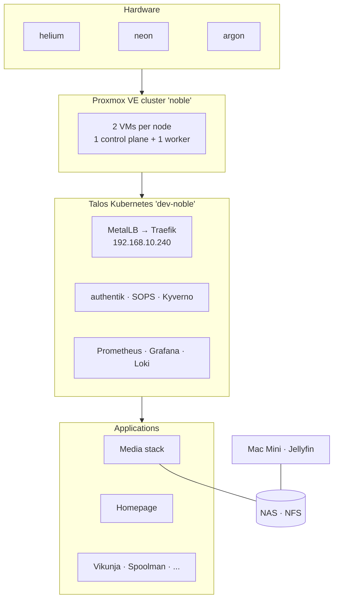

# Current stack

What runs in the lab today. Everything here is live on the
development cluster, <code>dev-noble</code>.

!!! tip "See it as a map"
    The [interactive stack explorer](../explore/index.md) draws all of
    this from the repository. Click any node, VM, or app to see its
    details and connections.

-   :material-server:{ .lg .middle } **[Hardware](hardware.md)**

    ---

    Three mini PCs, a UniFi gateway, two Flex switches, a NAS, and a
    Mac Mini for Jellyfin.

-   :material-kubernetes:{ .lg .middle } **[Platform](platform.md)**

    ---

    Talos, ArgoCD, Traefik, MetalLB, cert-manager, authentik, and the
    monitoring stack.

-   :material-shield-lock-outline:{ .lg .middle } **[Security](security.md)**

    ---

    SOPS secrets, SSO, Kyverno policies, NetworkPolicies, host
    hardening, and CI scans.

-   :material-apps:{ .lg .middle } **[Apps](apps.md)**

    ---

    The media stack, Homepage, Vikunja, Spoolman, and every other
    Application with its URL.

## How the layers fit

## Key facts

| | |
|---|---|
| Proxmox cluster | `noble` · 3 nodes · dual-link corosync |
| Kubernetes cluster | `dev-noble` · Talos `v1.13.7` · 3 control plane + 3 worker |
| API endpoint | `https://192.168.10.160:6443` |
| Ingress | Traefik on `192.168.10.240`, `*.lab.pcenicni.dev` |
| TLS | Let's Encrypt, DNS-01 through Cloudflare |
| Identity | authentik at `auth.lab.pcenicni.dev` (OIDC and forward-auth) |
| Secrets | SOPS + age, decrypted in-cluster by sops-secrets-operator |
| CNI | Flannel (Talos default). Cilium is staged, not active |
| App storage | `local-path` on each VM; media over NFS from the NAS |
| Dependency updates | Renovate PRs, auto-merged after CI passes |

!!! info "Development cluster, real workloads"
    `dev-noble` is called "development" because it stands in for the
    planned six-node production design. It still runs the real household
    apps. See [Future stack](../future/index.md) for what replaces it.
