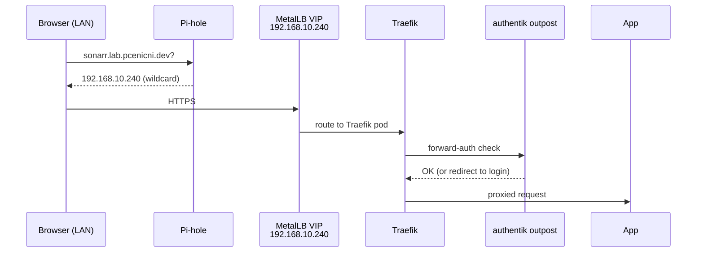
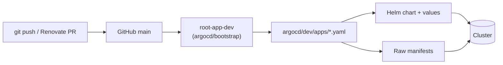

# Platform

The shared services every app relies on: how traffic gets
in, how apps get certificates and logins, and how the cluster is
watched.

## Request path

## Components

=== "Delivery"

    | Component | Job |
    |---|---|
    | **Talos Linux** `v1.13.7` | Immutable, API-managed OS for every Kubernetes node. No SSH |
    | **ArgoCD** | App-of-apps GitOps. Manages itself and every other Application |
    | **Renovate** | Opens dependency PRs. CI then auto-merges them |
    | **Ballast** | Rightsizes CPU and memory requests for opted-in apps |
    | **Harbor** | Container registry at `registry.lab.pcenicni.dev` |

=== "Networking"

    | Component | Job |
    |---|---|
    | **Flannel** | Pod network (Talos default) |
    | **MetalLB** | Gives `LoadBalancer` services addresses `192.168.10.240`-`.245` |
    | **Traefik** | Ingress controller and TLS termination |
    | **CoreDNS patch** | Pods resolve lab hostnames straight to Traefik |
    | **WireGuard** (wg-easy) | Remote access VPN on `192.168.10.244` UDP 51820 |
    | **Cilium** | Staged replacement for Flannel and kube-proxy |

=== "Identity and TLS"

    | Component | Job |
    |---|---|
    | **authentik** | SSO. OIDC for ArgoCD, Grafana, Headlamp, Harbor, Vikunja. Forward-auth for apps without login |
    | **Kubernetes OIDC** | kube-apiserver trusts authentik for `kubectl` and Headlamp |
    | **cert-manager** | Let's Encrypt certificates through a Cloudflare DNS-01 challenge |
    | **sops-secrets-operator** | Decrypts `SopsSecret` resources from git into Secrets |

=== "Observability"

    | Component | Job |
    |---|---|
    | **Prometheus** | Metrics from the cluster, ArgoCD, authentik, and Proxmox |
    | **Grafana** | Dashboards at `grafana.lab.pcenicni.dev` |
    | **Loki + Alloy** | Log collection from every pod |
    | **pve-exporter** | Proxmox metrics through a read-only API token |
    | **Headlamp** | Web UI for Kubernetes at `headlamp.lab.pcenicni.dev` |

## GitOps flow

Every Application uses automated sync with `prune` and `selfHeal`, so
manual changes in the cluster are reverted. The exception is `cilium`,
which syncs by hand only.

## Storage

| Data | Where it lives | Backed up? |
|---|---|---|
| App config and databases | `local-path` PVC on the VM's disk | No - see [DR](../operations/disaster-recovery.md) |
| Media library and downloads | NFS from the NAS | On the NAS only |
| Prometheus and Loki data | `local-path` | No (rebuildable) |
| Declarative config | Git | Yes |
