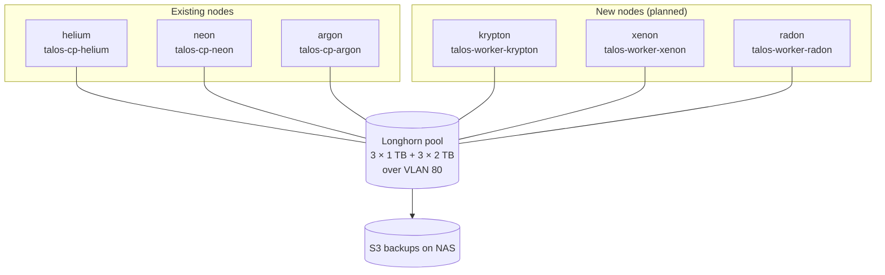

# Production cluster

The target-state Kubernetes cluster. The Terraform for it
is in <code>terraform/</code> as a scaffold. It is not applied.

## Topology

| VM | Role | Host | vCPU | RAM | Boot | Longhorn SSD | Mgmt IP | Storage IP |
|---|---|---|---|---|---|---|---|---|
| talos-cp-helium | control plane | helium | 5 | 14 GiB | 64 GiB | 1 TB | `.10.101` | `.80.101` |
| talos-cp-neon | control plane | neon | 5 | 14 GiB | 64 GiB | 1 TB | `.10.102` | `.80.102` |
| talos-cp-argon | control plane | argon | 5 | 14 GiB | 64 GiB | 1 TB | `.10.103` | `.80.103` |
| talos-worker-krypton | worker | krypton | 8 | 16 GiB | 32 GiB | 2 TB | `.10.104` | `.80.104` |
| talos-worker-xenon | worker | xenon | 8 | 16 GiB | 32 GiB | 2 TB | `.10.105` | `.80.105` |
| talos-worker-radon | worker | radon | 8 | 16 GiB | 32 GiB | 2 TB | `.10.106` | `.80.106` |

Mgmt IPs are in `192.168.10.0/24`, storage IPs in `192.168.80.0/24`.

## What changes from the development cluster

| | Development | Production |
|---|---|---|
| VMs per node | 2 (CP + worker) | 1 |
| VM storage | `local-lvm` | Dedicated SSD per node |
| Second NIC on VLAN 80 | Off | On, through new `vmbr2` bridges |
| ArgoCD tree | `argocd/dev/` | `argocd/prod/` + `argocd/shared/` |
| Terraform | `development/terraform/` | `terraform/` |

## Read more

- [Talos and Kubernetes architecture](../reference/architecture/talos.md) -
  the full design, phased rollout, and core apps.
- [Proxmox architecture](../reference/architecture/proxmox.md#extending-to-6-nodes) -
  extending the Proxmox cluster to six nodes.
- [Media stack architecture](../reference/architecture/media-stack.md) -
  the target NAS layout and request flow.
