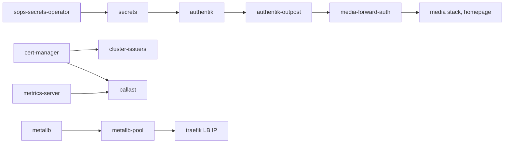

# 5. GitOps and secrets

This step installs ArgoCD, adds the two secrets that cannot live in git,
and hands the cluster to GitOps. After this step, git is the source of
truth for every workload. The full reference is
[`argocd/README.md`](https://github.com/nikpcenicni/Nikflix/blob/main/argocd/README.md).

## 1. Install the bootstrap secrets

These two secrets must exist before ArgoCD syncs anything that needs them.

**SOPS age key** - decrypts every `SopsSecret` under
`argocd/dev/manifests/secrets/`:

```sh
# New lab: generate a key. Recovery: use your saved age-key.txt instead.
age-keygen -o age-key.txt

kubectl create namespace sops
kubectl -n sops create secret generic sops-age-key --from-file=keys.txt=age-key.txt
```

For a new lab, put the `# public key:` line from `age-keygen` into the
`age:` field of `.sops.yaml`. Then re-encrypt every file in
`argocd/dev/manifests/secrets/` with your own values (you cannot decrypt
the existing ones).

**Cloudflare API token** - used by the Let's Encrypt cluster issuers:

```sh
kubectl create namespace cert-manager
kubectl -n cert-manager create secret generic cloudflare-api-token \
  --from-literal=api-token='<cloudflare-token>'
```

## 2. Install ArgoCD

```sh
kubectl create namespace argocd
kubectl apply -n argocd --server-side -f argocd/dev/manifests/argocd/install.yaml
kubectl -n argocd rollout status deploy/argocd-server
```

`install.yaml` is the vendored ArgoCD manifest that ArgoCD later manages
itself, so the version matches git.

## 3. Apply the root Applications

```sh
kubectl apply -f argocd/bootstrap/root-app-shared.yaml
kubectl apply -f argocd/bootstrap/root-app-dev.yaml
```

Do not apply any other Application by hand. ArgoCD creates the rest from
`argocd/dev/apps/`.

## Sync order

Applications converge on their own through retries. These dependencies
explain the errors you see during the first sync:



## Check

```sh
kubectl -n argocd get applications
```

Every Application is `Synced` and `Healthy`, except `cilium`, which stays
`OutOfSync` on purpose. Do not sync `cilium` until you do the Flannel
migration described in `argocd/dev/values/cilium-values.yaml`. `kubectl get svc -n traefik`
shows `192.168.10.240` as the external IP.

!!! note "Change for your lab"
    - `repoURL` in every file in `argocd/bootstrap/` and `argocd/dev/apps/`
      (`grep -rl 'repoURL:' argocd`).
    - `dnsZones` and email in `argocd/dev/manifests/cluster-issuers/`.
    - MetalLB range in `argocd/dev/manifests/metallb-pool/`.
    - Every `*.lab.pcenicni.dev` host name in `argocd/dev/values/` and
      `argocd/dev/manifests/`.
    - NFS server and paths in the media values files.
