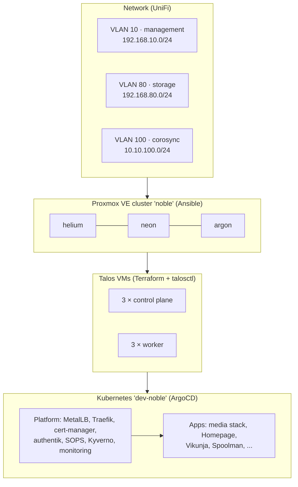

# Nikflix

Nikflix is a home lab defined as code. A three-node Proxmox cluster hosts
Talos Linux VMs. The VMs run Kubernetes. ArgoCD deploys every
application on the cluster from this git repository.

This site has two jobs:

1. **Build a copy of the lab.** Follow [Build the lab](guide/index.md)
   from start to finish, on your own hardware.
2. **Recover the lab after a failure.** Go to
   [Disaster recovery](disaster-recovery.md). It tells you which secrets
   you must have, and in which order to rebuild.

## The stack, layer by layer

| Layer | Tool | Repo path | Guide step |
|---|---|---|---|
| Network | UniFi (by hand) | - | [1. Network](guide/network.md) |
| Proxmox hosts | Ansible | `ansible/` | [2. Proxmox nodes](guide/proxmox.md) |
| VM shells | Terraform (`bpg/proxmox`) | `development/terraform/` | [3. Talos VMs](guide/vms.md) |
| OS and Kubernetes | `talosctl` | `development/talos/` | [4. Talos and Kubernetes](guide/talos.md) |
| Workloads | ArgoCD + SOPS | `argocd/` | [5. GitOps](guide/gitops.md), [6. Applications](guide/apps.md) |

## Current state

- **Development cluster (`dev-noble`)** - runs today. Six Talos VMs, two
  per Proxmox node. Every procedure on this site uses this cluster.
- **Production cluster** - a design only. It needs three more Proxmox
  nodes (`krypton`, `xenon`, `radon`). See
  [Talos and Kubernetes](architecture/talos.md).

!!! note "Adapting this to your own lab"
    The repository uses real addresses, a real domain
    (`lab.pcenicni.dev`), and a real git remote. To build your own copy,
    fork the repository and replace these values. Each guide step has a
    **Change for your lab** box that lists them.
