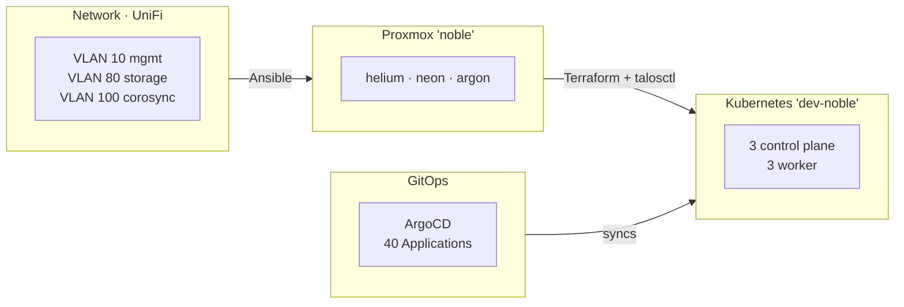

---
hide:
  - navigation
  - toc
---

# Nikflix

A home lab defined as code. Proxmox hosts Talos Linux VMs, the VMs run
Kubernetes, and ArgoCD deploys everything on the cluster from git. These
docs explain how it works, how to build your own, and how to bring it
back after a failure.

[Explore the stack :material-arrow-right:](current/index.md){ .md-button .md-button--primary }
[Build your own](tutorials/build/index.md){ .md-button }
[Disaster recovery](operations/disaster-recovery.md){ .md-button }

<b>3</b>Proxmox nodes

<b>6</b>Talos VMs

<b>40</b>ArgoCD Applications

<b>3</b>Isolated VLANs

<b>0</b>Plaintext secrets in git

## Where to go

-   :material-layers-triple:{ .lg .middle } **Current stack**

    ---

    What runs today: hardware, network, Kubernetes platform, security
    controls, and every app.

    [:octicons-arrow-right-24: Current stack](current/index.md)

-   :material-rocket-launch-outline:{ .lg .middle } **Future stack**

    ---

    The roadmap: a six-node production cluster, Longhorn storage,
    Cilium, and external access.

    [:octicons-arrow-right-24: Roadmap](future/index.md)

-   :material-school-outline:{ .lg .middle } **Tutorials**

    ---

    Build the lab from bare metal, then everyday tasks: add an app,
    manage secrets, add a node, upgrade Talos.

    [:octicons-arrow-right-24: Tutorials](tutorials/index.md)

-   :material-lifebuoy:{ .lg .middle } **Operations**

    ---

    Disaster recovery runbooks, what to back up, and routine
    maintenance.

    [:octicons-arrow-right-24: Operations](operations/index.md)

-   :material-lan:{ .lg .middle } **Reference**

    ---

    IP plan, port map, DNS, repository layout, and the full
    architecture write-ups.

    [:octicons-arrow-right-24: Reference](reference/index.md)

-   :material-frequently-asked-questions:{ .lg .middle } **Questions**

    ---

    FAQ, and the design decisions that are still open.

    [:octicons-arrow-right-24: Questions](faq.md)

## The stack at a glance

| Layer | Tool | Status |
|---|---|---|
| Network | UniFi, configured by hand | Running |
| Proxmox cluster `noble` | Ansible | Running |
| Development cluster `dev-noble` | Terraform + Talos | Running |
| Platform and apps | ArgoCD + SOPS | Running |
| Production cluster | Terraform + Talos | Planned |
| Longhorn storage | ArgoCD | Planned |
