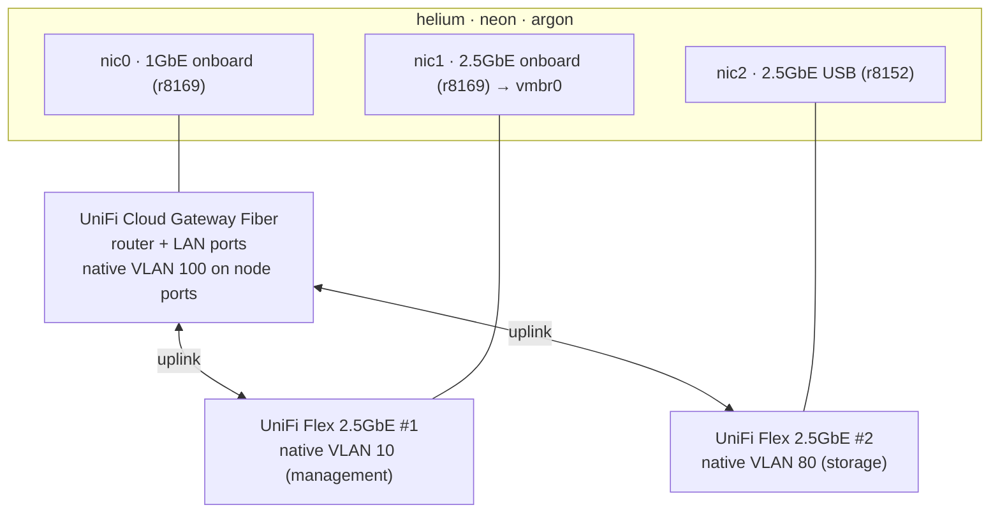

# Networking and port map

This page is the reference for every network, address, and physical
connection the lab uses. The
[Proxmox cluster architecture](architecture/proxmox.md) page explains
why the network has this design.

## VLANs

| VLAN | Name | Subnet | Gateway | Tagging on node ports | Carries |
|---|---|---|---|---|---|
| 10 | Management | `192.168.10.0/24` | `192.168.10.1` | Native (untagged) | Proxmox GUI/API/SSH, Talos VMs, Kubernetes API, MetalLB service IPs, corosync fallback (`link1`) |
| 80 | Storage | `192.168.80.0/24` | `.1` exists, nodes do not use it | Native (untagged) | Proxmox storage traffic. Planned: Longhorn replication and backups |
| 100 | Corosync | `10.10.100.0/24` | `.1` exists, nodes do not use it | Native (untagged) | Proxmox cluster heartbeat (`link0`) only |
| 50 | Legacy NAS | `192.168.50.0/24` | - | - | Interim OpenMediaVault NAS that serves the media NFS shares |

!!! warning "Native VLANs, not tagged trunks"
    Every node-facing switch port sends and expects **untagged** frames.
    Set each port's native VLAN in UniFi. Do not configure `nic0.100` or
    `nic2.80` sub-interfaces on the node; they come up but pass no
    traffic. Confirm with `tcpdump -e -i nic0` before you change this.

Turn off DHCP for the reserved node and VM addresses on every subnet
above, or reserve them outside the DHCP range.

## IP address plan

### Proxmox nodes

| Node | Management (VLAN 10, `vmbr0`) | Corosync (VLAN 100, `nic0`) | Storage (VLAN 80, `nic2`) | Status |
|---|---|---|---|---|
| helium | `192.168.10.10` | `10.10.100.10` | `192.168.80.10` | Active, cluster founder |
| neon | `192.168.10.20` | `10.10.100.20` | `192.168.80.20` | Active |
| argon | `192.168.10.30` | `10.10.100.30` | `192.168.80.30` | Active |
| krypton | `192.168.10.40` | `10.10.100.40` | `192.168.80.40` | Planned |
| xenon | `192.168.10.50` | `10.10.100.50` | `192.168.80.50` | Planned |
| radon | `192.168.10.60` | `10.10.100.60` | `192.168.80.60` | Planned |

### Talos VMs (development cluster)

| VM | VM ID | Host | Role | Management IP | Storage IP (not attached yet) |
|---|---|---|---|---|---|
| talos-dev-cp-helium | 201 | helium | control plane | `192.168.10.121` | `192.168.80.121` |
| talos-dev-worker-helium | 202 | helium | worker | `192.168.10.122` | `192.168.80.122` |
| talos-dev-cp-neon | 203 | neon | control plane | `192.168.10.123` | `192.168.80.123` |
| talos-dev-worker-neon | 204 | neon | worker | `192.168.10.124` | `192.168.80.124` |
| talos-dev-cp-argon | 205 | argon | control plane | `192.168.10.125` | `192.168.80.125` |
| talos-dev-worker-argon | 206 | argon | worker | `192.168.10.126` | `192.168.80.126` |

The production design reserves `192.168.10.101`-`.106` and
`192.168.80.101`-`.106`. See [Talos and Kubernetes](architecture/talos.md#cluster-topology).

### Cluster and service addresses

| Address | What it is | Set in |
|---|---|---|
| `192.168.10.160:6443` | Kubernetes API endpoint for `dev-noble` | `talosctl gen config`, `argocd/dev/values/cilium-values.yaml` |
| `192.168.10.240`-`.245` | MetalLB pool for `LoadBalancer` services | `argocd/dev/manifests/metallb-pool/` |
| `192.168.10.240` | Traefik ingress (every `*.lab.pcenicni.dev` host) | First address MetalLB assigns |
| `192.168.10.244` | WireGuard VPN (`wg.lab.pcenicni.dev`) | `argocd/dev/values/wireguard-values.yaml` |
| `192.168.10.245` | Bambuddy virtual printer | `argocd/dev/values/bambuddy-values.yaml` |

### Other devices the cluster depends on

| Device | Address | Why it matters |
|---|---|---|
| Pi-hole (primary) | `192.168.1.127` | LAN DNS. Holds the `*.lab.pcenicni.dev` → `192.168.10.240` wildcard |
| Interim NAS (OpenMediaVault) | `192.168.50.105` | NFS exports `/export/media`, `/export/torrents`, `/export/usenet` for the media stack |
| Mac Mini | DHCP / reserved in UniFi | Runs Jellyfin outside the cluster |

## Physical port map

Each Proxmox node has three NICs. Each NIC goes to a different network on
a different switch. No two networks share a switch.

### Per-node cabling

| Node | NIC | Speed / driver | Connects to | Native VLAN | Address |
|---|---|---|---|---|---|
| helium | `nic0` | 1GbE onboard, r8169 | Cloud Gateway Fiber LAN port | 100 | `10.10.100.10` |
| helium | `nic1` (`vmbr0`) | 2.5GbE onboard, r8169 | Flex 2.5GbE #1 | 10 | `192.168.10.10` |
| helium | `nic2` | 2.5GbE USB, r8152 (MAC `00:e0:4c:68:01:59`) | Flex 2.5GbE #2 | 80 | `192.168.80.10` |
| neon | `nic0` | 1GbE onboard, r8169 | Cloud Gateway Fiber LAN port | 100 | `10.10.100.20` |
| neon | `nic1` (`vmbr0`) | 2.5GbE onboard, r8169 | Flex 2.5GbE #1 | 10 | `192.168.10.20` |
| neon | `nic2` | 2.5GbE USB, r8152 | Flex 2.5GbE #2 | 80 | `192.168.80.20` |
| argon | `nic0` | 1GbE onboard, r8169 | Cloud Gateway Fiber LAN port | 100 | `10.10.100.30` |
| argon | `nic1` (`vmbr0`) | 2.5GbE onboard, r8169 | Flex 2.5GbE #1 | 10 | `192.168.10.30` |
| argon | `nic2` | 2.5GbE USB, r8152 | Flex 2.5GbE #2 | 80 | `192.168.80.30` |

### Per-switch port assignments

!!! todo "Record port numbers"
    The repository records which switch each NIC connects to, but not
    the exact port numbers. Fill in the **Port** column from the UniFi
    console (Devices → *switch* → Ports) and keep this table current. In
    a rebuild, any free port works if you set its native VLAN as listed.

| Switch | Port | Connected device | Native VLAN |
|---|---|---|---|
| Cloud Gateway Fiber | WAN | ISP uplink | - |
| Cloud Gateway Fiber | _record_ | helium `nic0` | 100 |
| Cloud Gateway Fiber | _record_ | neon `nic0` | 100 |
| Cloud Gateway Fiber | _record_ | argon `nic0` | 100 |
| Cloud Gateway Fiber | _record_ | Uplink to Flex 2.5GbE #1 | trunk (all) |
| Cloud Gateway Fiber | _record_ | Uplink to Flex 2.5GbE #2 | trunk (all) |
| Flex 2.5GbE #1 | _record_ | Uplink to Cloud Gateway Fiber | trunk (all) |
| Flex 2.5GbE #1 | _record_ | helium `nic1` | 10 |
| Flex 2.5GbE #1 | _record_ | neon `nic1` | 10 |
| Flex 2.5GbE #1 | _record_ | argon `nic1` | 10 |
| Flex 2.5GbE #2 | _record_ | Uplink to Cloud Gateway Fiber | trunk (all) |
| Flex 2.5GbE #2 | _record_ | helium `nic2` | 80 |
| Flex 2.5GbE #2 | _record_ | neon `nic2` | 80 |
| Flex 2.5GbE #2 | _record_ | argon `nic2` | 80 |

When you add `krypton`, `xenon`, or `radon`, cable them the same way:
`nic0` to a VLAN 100 port, `nic1` to a VLAN 10 port, `nic2` to a VLAN 80
port.

## DNS

| Who asks | Resolver | How `*.lab.pcenicni.dev` resolves |
|---|---|---|
| LAN clients | Pi-hole `192.168.1.127` | dnsmasq wildcard `address=/.lab.pcenicni.dev/192.168.10.240`. Exact local records win over the wildcard |
| Pods | CoreDNS | `argocd/dev/manifests/coredns/` points selected hosts straight at Traefik |
| kube-apiserver (host network) | Node resolver | `StaticHostConfig` in each `cp-*.yaml` patch maps `auth.lab.pcenicni.dev` → `192.168.10.240` |

TLS certificates come from Let's Encrypt through a Cloudflare DNS-01
challenge on the `pcenicni.dev` zone, so no inbound port forward is
needed for certificates.

## Inbound from the internet

Every web app is LAN-only. The only service built for outside access is
WireGuard (UDP `51820` on `192.168.10.244`). To use it from outside,
forward WAN UDP 51820 to `192.168.10.244:51820` on the gateway.

!!! note "Change for your lab"
    Replace the subnets, node IPs, MetalLB range, the Pi-hole wildcard,
    and the domain. Search the repository with
    `grep -rn '192.168.10\|lab.pcenicni.dev' ansible development argocd`.
